<!-- ═══════════════════════════════════════════════════════════
     PHIMHAY24H MOBILE — Cinema Neon README
     Flutter + Firebase + Gemini Voice · Phenikaa University · Nhóm 4
═══════════════════════════════════════════════════════════ -->
<div align="center">


<p align="center">
  
</p>

<p align="center">
  
  
  
  
  
  
</p>

<p align="center">
  
  
  
  
  
  
</p>

<p align="center">
  <a href="https://phimhay24h.onrender.com"></a>
  &nbsp;
  <a href="https://github.com/hung123-alt/mobile/actions"></a>
  &nbsp;
  <a href="#️-cài-đặt--chạy-nhanh"></a>
</p>


</div>

## 📋 Mục lục

<div align="center">

| | | | |
|:---:|:---:|:---:|:---:|
| [✨ Giới thiệu](#-giới-thiệu) | [🚀 Tính năng](#-tính-năng-nổi-bật) | [🔐 Demo tài khoản](#-demo-tài-khoản) | [🛠️ Module](#️-chức-năng-chính-theo-module) |
| [🧰 Công nghệ](#️-công-nghệ-sử-dụng) | [📁 Cấu trúc](#-cấu-trúc-dự-án-do-nhóm-tự-vẽ) | [🗄️ Dữ liệu](#️-mô-hình-dữ-liệu-firestore) | [🛡️ Bảo mật](#️-kiến-trúc-bảo-mật-do-nhóm-tự-vẽ) |
| [📊 Sơ đồ](#-sơ-đồ-hệ-thống-15-ảnh--2-sơ-đồ-tự-vẽ) | [🧪 Kiểm thử](#-kiểm-thử--kiểm-định-8a--8e) | [⚙️ Cài đặt](#️-cài-đặt--chạy-nhanh) | [👥 Nhóm](#-nhóm-phát-triển) |

</div>

<div align="center">


</div>

## ✨ Giới thiệu

**PhimHay24h Mobile** là ứng dụng xem phim trực tuyến đa nền tảng viết bằng **Flutter**, chạy trên **Android (APK)**, **Web PWA (Render)** và mọi nền tảng Flutter hỗ trợ.

Ba điểm khiến bản mobile khác biệt:

- **🔥 Firebase-native:** `firebase_auth` thay cho bảng `users` + JWT của NestJS, `cloud_firestore` thay cho MySQL — mọi phân quyền dồn về **`cinema_app/firestore.rules`** (hàm `isSignedIn()`, `isAdmin()`, `ownsProfile()`, `hasNoPlaintextPassword()`).
- **🎙️ Trợ lý giọng nói Lina / Seven:** `speech_to_text` + `flutter_tts` + `gemini_client` — bấm orb, nói *"tìm phim hành động"*, trợ lý tự mở trang tìm kiếm / chi tiết phim.
- **📦 Một codebase — hai đầu ra:** cùng một `cinema_app/` build ra **Web PWA qua Docker + Nginx trên Render** (`https://phimhay24h.onrender.com`) và **APK Android qua GitHub Actions** (`build-apk.yml` → `app-release.apk` ~59 MB, test được trên Appetize.io).

> 💡 Repo này là **nhánh `main` — bản Mobile**: `cinema_app/` (Flutter) + `server/` (NestJS tham khảo) + `client/` (React tham khảo) + `.github/workflows/build-apk.yml` (CI build APK) + `Dockerfile`/`render.yaml` (deploy Web).

<div align="center">


</div>

## 🚀 Tính năng nổi bật

```
🎬 Xem phim              →  WebView nhúng, chọn tập, phát video, tự chuyển tập
⏯️  Xem tiếp              →  Lưu tiến độ theo tập (watch_history), gợi ý tiếp tục
🔎 Tìm kiếm & Lọc         →  Debounce 400ms, lọc Thể loại + Quốc gia + Năm + Loại phim
🎲 Random phim            →  Random nhanh & Random nâng cao (trang Random)
💬 Bình luận & Đánh giá   →  Reply lồng nhau, chấm sao 1–10, chặn XSS từ client
❤️  Cá nhân hóa           →  Yêu thích · Xem sau · Lịch sử xem riêng từng user
🎙️  Trợ lý Lina/Seven     →  Ra lệnh giọng nói, đọc kết quả bằng TTS, mở phim bằng lời nói
🔐 Firebase Auth          →  Đăng ký / Đăng nhập / Quên & Đặt lại mật khẩu (deep link)
🌗 Dark / Light           →  ThemeProvider + lưu SharedPreferences, đổi tức thì
🛡️  Bảo mật nhiều lớp     →  SecureStorage · InputSanitizer · RateLimiter · Rules
📊 Admin Dashboard        →  Quản lý phim / tập / thể loại / user / bình luận / báo lỗi
📩 Chia sẻ & Deep link    →  share_plus + app_links, mở link là vào đúng phim
```

<div align="center">


</div>

## 🔐 Demo tài khoản

| Vai trò | Email | Mật khẩu | Quyền hạn |
|---------|-------|----------|-----------|
| 👑 **Admin** | `admin@phimhay24.com` | `admin123` | Toàn quyền — duyệt CRUD phim/tập/danh mục, khóa user, xử lý báo lỗi, xem dashboard |
| 👤 **User** | `user@phimhay24.com` | `admin123` | Xem phim, bình luận, đánh giá 1–10, yêu thích, xem sau, lịch sử, báo lỗi video |

> ⚠️ Tài khoản demo nằm trên project Firebase **`cinema-app-b760e`**. Nếu đăng nhập báo lỗi `operation-not-allowed`, hãy bật **Email/Password provider** trong Firebase Console → Authentication → Sign-in method.

<div align="center">


</div>

## 🛠️ Chức năng chính theo module

| Module (mobile) | Màn hình / Chức năng |
|--------|-----------|
| **Auth** | Đăng ký / Đăng nhập / Quên & Đặt lại mật khẩu (`forgot_password_page`, `reset_password_page` + `DeepLinkService`), lưu phiên bằng `AuthProvider` |
| **Home** | `home_page` + `hero_banner_carousel` + `trending_carousel` + `movie_row_section` — banner, trending, danh sách theo thể loại |
| **Search** | `search_page` + `search_input` (debounce) — tìm theo từ khóa, mở chi tiết |
| **Category** | `category_page` — lọc kết hợp thể loại / quốc gia / năm / loại phim |
| **Movie Detail** | `movie_detail_page` + `episode_grid` + `comment_section` + `rating_modal` — xem info, chọn tập, bình luận, chấm sao |
| **Player** | `player_page` + `embed_video_player` (mobile/web/stub) — phát video, chuyển tập, báo lỗi (`error_report_modal`) |
| **Comments** | Bình luận lồng nhau, `InputSanitizer.cleanText()` cắt HTML trước khi gửi, server/Firestore rules chặn tiếp |
| **Ratings** | Chấm sao 1–10 (`rating_stars`), upsert một user một điểm/phim |
| **Favorites / Watchlist** | `favorite_page`, `watchlist_provider`/`watchlist_repository` — toggle tim, đồng bộ Firestore |
| **Watch History** | `watch_history_page` + `watch_history_provider` — tự lưu tiến độ, hỗ trợ "Xem tiếp" |
| **Random** | `random_page` — random nhanh & nâng cao theo bộ lọc |
| **Voice Assistant** | `assistant_orb` + `assistant_panel` + `assistant_brain` + `gemini_client` — STT → Gemini → TTS + điều hướng |
| **Admin** | `admin_dashboard_page` + 5 tab (`admin_movies_tab`, `admin_users_tab`, `admin_comments_tab`, `admin_genres_tab`, `admin_notifications_tab`) + `admin_movie_edit_page` |
| **Profile** | `profile_page` + `account_info_page` — đổi theme, xem thông tin, đăng xuất (xóa sạch token) |

<div align="center">


</div>

## 🧰 Công nghệ sử dụng

<div align="center">

[](https://skillicons.dev)

</div>

<br/>

| Layer | Công nghệ | Ghi chú |
|-------|-----------|---------|
| **Mobile UI** | Flutter 3.x + Dart (`sdk >=3.12.0`) | Material 3, `ListenableBuilder`, `NavigationShell` (Bottom Nav) |
| **State** | Provider thủ công (`AuthProvider`, `ThemeProvider`, `WatchlistProvider`, `WatchHistoryProvider`, `ToastProvider`) | Singleton + `ListenableBuilder`, không dùng Riverpod/Bloc để giữ code gọn cho đồ án |
| **Backend chính** | Firebase Auth + Cloud Firestore | Auth thay JWT NestJS; Firestore thay MySQL; rules ở `cinema_app/firestore.rules` |
| **Backend tham khảo** | NestJS 11 + TypeORM + MySQL (thư mục `server/`) | Giữ lại để đối chiếu kiến trúc module hóa với bản web |
| **Trợ lý giọng nói** | `speech_to_text` + `flutter_tts` + `gemini_client` (Google Gemini) | Persona Lina/Seven, `assistant_brain` điều hướng bằng lời nói |
| **Video** | `webview_flutter` + `embed_video_player` (mobile/web/stub) + `video_source.dart` | Phân loại HLS / Direct / Iframe, lọc scheme `javascript:`/`file://` |
| **Lưu trữ bí mật** | `flutter_secure_storage` (Keychain iOS / EncryptedSharedPreferences Android) | Token **không** nằm ở SharedPreferences XML plaintext |
| **Lưu trữ thường** | `shared_preferences` | Chỉ lưu `theme_mode`, cache UI không nhạy cảm |
| **Chia sẻ / Link** | `share_plus` + `app_links` + `DeepLinkService` | Share phim, deep link quên mật khẩu |
| **Deploy Web** | Docker multi-stage (Flutter stable → Nginx Alpine) + `render.yaml` | Live tại `https://phimhay24h.onrender.com` |
| **Build APK** | GitHub Actions `.github/workflows/build-apk.yml` | `app-release.apk` ~59 MB, test trên Appetize.io |
| **Kiểm thử** | `flutter_test` (13 file, 157 ca — xem mục 🧪) | Bao phủ yêu cầu 8a–8e |

<div align="center">


</div>

## 📁 Cấu trúc dự án (do nhóm tự vẽ)

> 🌳 Cây thư mục dưới đây do nhóm tự vẽ từ mã nguồn thật của nhánh `main` (không copy từ bản web) — phản ánh đúng `cinema_app/lib` hiện tại.

<details open>
<summary><b>📂 Bấm để thu gọn / mở rộng cây thư mục Mobile (cinema_app/)</b></summary>

```
mobile/  (repo root — nhánh main)
├── .github/workflows/build-apk.yml     → CI: Flutter stable → build app-release.apk (~59MB)
├── cinema_app/Dockerfile               → Multi-stage: flutter build web → nginx:alpine serve
├── render.yaml                         → Deploy Web PWA (dockerContext: .)
├── .dockerignore                       → Loại build/, .dart_tool/ khỏi context
├── Capture.PNG                         → Ảnh chụp màn hình demo cũ
├── README.md                           → Chính file này
│
├── docs/
│   └── images/                         → 15 ảnh sơ đồ của nhóm (Class, KT tổng thể, SE, AC, Mobile flows)
│       ├── ClassDiagrams.drawio.png
│       ├── KTTongThe.drawio.png
│       ├── SE_QLLSXEM.drawio.png / SE_QuanLyPhimYeuThich.png / Se_XemChiTietPhim.png
│       ├── ACLogin.png / AcTimKiemLocPhim.png / AC_BandAcc.png / AC_ChonTapVaPhatVideo.png
│       └── Movies_Mobile-*.png (Login, Dang ky, search, watch, comment, like_dislike)
│
├── scripts/                            → Script phụ trợ repo
│
└── cinema_app/                         → 📱 APP FLUTTER (thư mục quan trọng nhất)
    ├── pubspec.yaml                    → flutter 3.x, firebase_auth, cloud_firestore,
    │                                     speech_to_text, flutter_tts, webview_flutter,
    │                                     flutter_secure_storage, share_plus, app_links
    ├── firebase.json                   → Cấu hình Firebase project
    ├── firestore.rules                 → ⭐ Luật phân quyền (isSignedIn/isAdmin/ownsProfile/...)
    ├── lib/
    │   ├── main.dart                   → Entry: init Firebase → Theme → Auth → DeepLink → runApp
    │   ├── firebase_options.dart        → Cấu hình Firebase theo platform (flutterfire)
    │   │
    │   ├── assistant/                  → 🎙️ Trợ lý giọng nói Lina/Seven
    │   │   ├── assistant_brain.dart     → Bộ não: hiểu lệnh → chọn tool điều hướng
    │   │   ├── assistant_manager.dart   → Điều phối orb/panel/brain
    │   │   ├── assistant_orb.dart       → Nút orb nổi (bấm để nói)
    │   │   ├── assistant_panel.dart     → Panel hội thoại
    │   │   ├── assistant_persona.dart   → Tính cách Lina/Seven
    │   │   ├── assistant_settings.dart  → Bật/tắt giọng nói
    │   │   ├── assistant_tools.dart     → Tool: mở tìm kiếm / mở phim / ...
    │   │   ├── gemini_client.dart       → Gọi Google Gemini
    │   │   ├── text_normalizer.dart     → Chuẩn hóa tiếng Việt cho STT
    │   │   └── voice_assistant_service.dart → STT + TTS nền
    │   │
    │   ├── core/
    │   │   ├── constants/               → app_colors.dart, app_constants.dart (màu, hằng số)
    │   │   ├── extensions/              → hex_color.dart
    │   │   ├── firebase/               → auth_service, firebase_service, collection_names,
    │   │   │                             deep_link_service, user_auth_map_service
    │   │   ├── security/               → 🛡️ input_sanitizer (XSS) · rate_limiter (spam)
    │   │   │                             · secure_token_storage (Keychain/EncryptedPrefs)
    │   │   ├── theme/                  → app_theme.dart (Light/Dark Material 3)
    │   │   └── utils/                  → validators (form) · generic_utils (search/filter/sort)
    │   │                                 · video_source (YouTube ID, HLS/Direct/Iframe)
    │   │
    │   ├── models/                     → Movie, Episode, Comment, Rating, Genre, Country,
    │   │                                 User, Notification, WatchlistItem, PageResult,
    │   │                                 ApiResponse, BaseEntity/IdEntity (parse mềm int/String/bool)
    │   ├── repositories/               → Repository Pattern: auth, movie, comment, watchlist
    │   │                                 (bắt ApiException ở biên → trả default an toàn)
    │   ├── services/                   → api_service, auth_service, movie_service,
    │   │                                 firestore_movie_service, comment/rating/watchlist/
    │   │                                 history/notification_service
    │   ├── providers/                  → auth_provider, theme_provider, toast_provider,
    │   │                                 watchlist_provider, watch_history_provider
    │   ├── routes/                     → app_routes.dart (tên route) + app_router.dart (bản đồ)
    │   ├── pages/                      → 17 màn hình:
    │   │                                 home / search / category / favorite / profile /
    │   │                                 movie_detail / player / random / watch_history /
    │   │                                 login / register / forgot+reset_password /
    │   │                                 account_info / forbidden / cinematic_intro /
    │   │                                 admin_dashboard + admin_movie_edit
    │   └── widgets/                    → 30 widget dùng chung:
    │                                       navigation_shell (Bottom Nav) · app_top/bottom_bar ·
    │                                       admin_*_tab (movies/users/comments/genres/notifications) ·
    │                                       movie_card/grid/row_section · hero_banner/trending_carousel ·
    │                                       episode_grid · comment_section · rating_stars/modal ·
    │                                       embed_video_player (+mobile/web/stub) · search_input ·
    │                                       custom_button · confirm_dialog · loading_spinner ·
    │                                       pagination · error_report_modal · movie_share_helper
    │
    ├── test/                           → 🧪 13 file, 157 ca — xem mục Kiểm thử 8a–8e
    │   ├── validators_test · input_sanitizer_test · video_source_test
    │   ├── generic_utils_test · rate_limiter_test
    │   ├── movie_model_test · models_extra_test · page_result_api_response_test
    │   ├── repositories_test · common_widgets_test · app_flow_test
    │   └── movie_interactions_test · widget_test
    ├── android/ ios/ web/ windows/ linux/ macos/  → Platform folders (web/ đã build PWA)
    └── tool/                           → Tool build nội bộ
```

</details>

<div align="center">


</div>

## 🗄️ Mô hình dữ liệu (Firestore)

Không còn 14 bảng MySQL như bản web — bản mobile dùng **collections Firestore** (NoSQL), quan hệ thể hiện bằng **subcollection + field tham chiếu**:

```
users/{profileId}                        → Hồ sơ (docId là chuỗi số, VD "12")
  ├── favorites/{movieSlug}              → Phim yêu thích (riêng từng user)
  ├── watchlist/{movieSlug}              → Xem sau
  └── notifications/{notifId}            → Thông báo cá nhân

user_auth_map/{profileId}                → Nối Firebase UID ↔ profileId { uid, email, role }
admins/{uid}                             → Danh sách UID admin (ghi: không cho phép từ client)

movies/{slug}                            → Phim (đọc: public)
  ├── episodes/{episodeId}               → Tập phim (ghi: chỉ admin)
  ├── ratings/{uidAuth}                 → Điểm 1–10 (mỗi UID một điểm/phim)
  └── comments/{commentId}              → Bình luận phim

comments/{commentId}                     → Bình luận top-level (userId INT + ownsProfile)
ratings/{ratingId}                       → Đánh giá dự phòng
genres/{id} · countries/{id}             → Danh mục (ghi: chỉ admin)
movie_genres/{id} · movie_countries/{id} → Bảng nối n–n
watch_history/{docId}                    → { userId INT, movieSlug, episodeId, position }
error_reports/{docId}                    → Báo lỗi video (tạo: signed-in; xử lý: admin)
notifications/{notifId}                  → Thông báo chung (ghi: chỉ admin)
favorites/{id} · watchlist/{id}          → Dự phòng top-level
```

- **Khóa logic:** cặp `(uidAuth, movieSlug)` cho ratings; `user_auth_map` khóa `role` (client không tự nâng admin).
- **Kiểu mềm:** `userId` là INT (id hồ sơ), `profileId` trên path là STRING — rules dùng `ownsProfile(string(...))` để nối.
- **Mặc định khóa hết:** `match /{document=**} { allow read, write: if false; }`.

<div align="center">


</div>

## 🛡️ Kiến trúc bảo mật (do nhóm tự vẽ)

> 🛡️ Sơ đồ dưới do nhóm **tự vẽ bằng Mermaid** vì 15 ảnh gốc chưa có sơ đồ bảo mật — tổng hợp từ `secure_token_storage.dart`, `input_sanitizer.dart`, `rate_limiter.dart`, `video_source.dart`, `validators.dart` và `firestore.rules`.

| Lớp | Cơ chế (file thật) | Chống gì |
|-----|-------------------|----------|
| **L1. Validate đầu vào** | `validators.dart` (required, email, password, rating 1–10) + `validateComment()` | Form sai, điểm lậu, comment rỗng |
| **L2. Làm sạch XSS** | `input_sanitizer.dart` — strip `<tags>`, gọn khoảng trắng, cắt 2000 ký tự; UI chỉ dùng `Text` (không render HTML) | `<script>`, paste HTML từ web |
| **L3. Token an toàn** | `secure_token_storage.dart` — access/refresh token vào Keychain / EncryptedSharedPreferences; logout xóa sạch; theme mới nằm SharedPreferences | Máy root đọc XML, token cũ sót lại |
| **L4. Chống spam** | `rate_limiter.dart` (1200 ms) + `SearchDebouncer` (400 ms) | Bấm liên tục, search dồn request |
| **L5. Video an toàn** | `video_source.dart` — chỉ nhận `https`, chặn `javascript:`/`file:`/`data:`/`http`, phân loại HLS/Direct/Iframe | Embed độc, mixed-content |
| **L6. Auth** | Firebase Auth + `AuthProvider.checkAuthStatus()` + `DeepLinkService` | Giả phiên, link reset giả |
| **L7. Phân quyền server** | `firestore.rules`: `isSignedIn()` / `isAdmin()` (check `admins/{uid}`) / `ownsProfile()` (qua `user_auth_map`) / `hasNoPlaintextPassword()` | Đọc trộm, tự nâng admin, lưu plaintext password |
| **L8. Mặc định từ chối** | `match /{document=**} { allow read, write: if false }` | Collection lạ bị lộ |

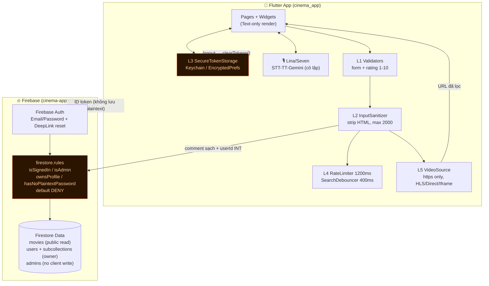

> 💡 **Đánh đổi đã phân tích:** mobile không có cookie HttpOnly nên token buộc nằm trên máy — nhóm tách hẳn 2 kho (bí mật → mã hóa, thường → SharedPreferences) và dồn mọi quyết định phân quyền về Rules phía server, client chỉ là lớp lọc sớm để tiết kiệm RAM/data.

<div align="center">


</div>

## 📊 Sơ đồ hệ thống (15 ảnh + 2 sơ đồ tự vẽ)

### 📐 Class Diagram — Model Mobile + Backend tham khảo

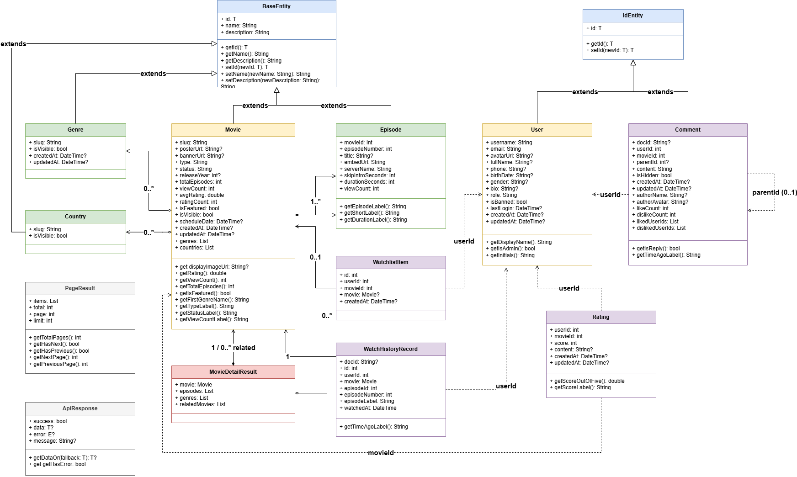

---

### 🧩 Kiến trúc tổng thể — Flutter + Firebase + Gemini + Render/APK

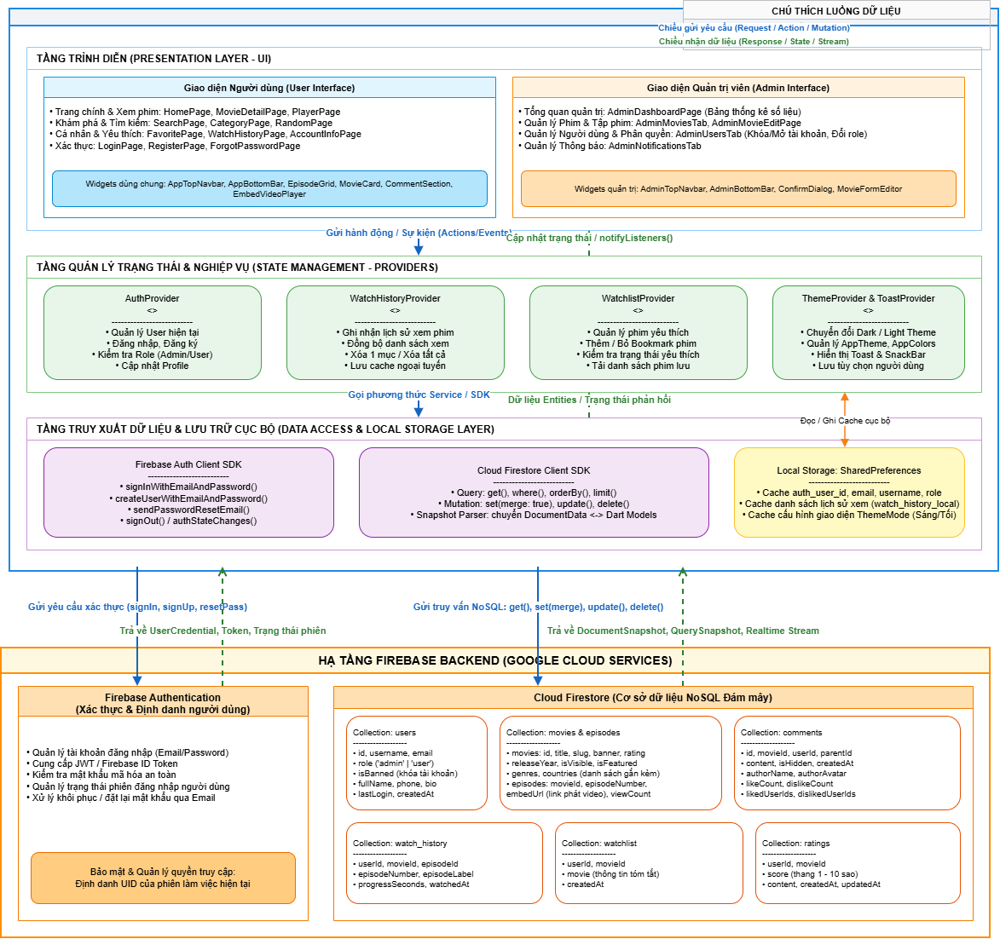

---

### 🔄 Activity Diagram — Luồng nghiệp vụ

#### 🔐 Đăng nhập (Login)

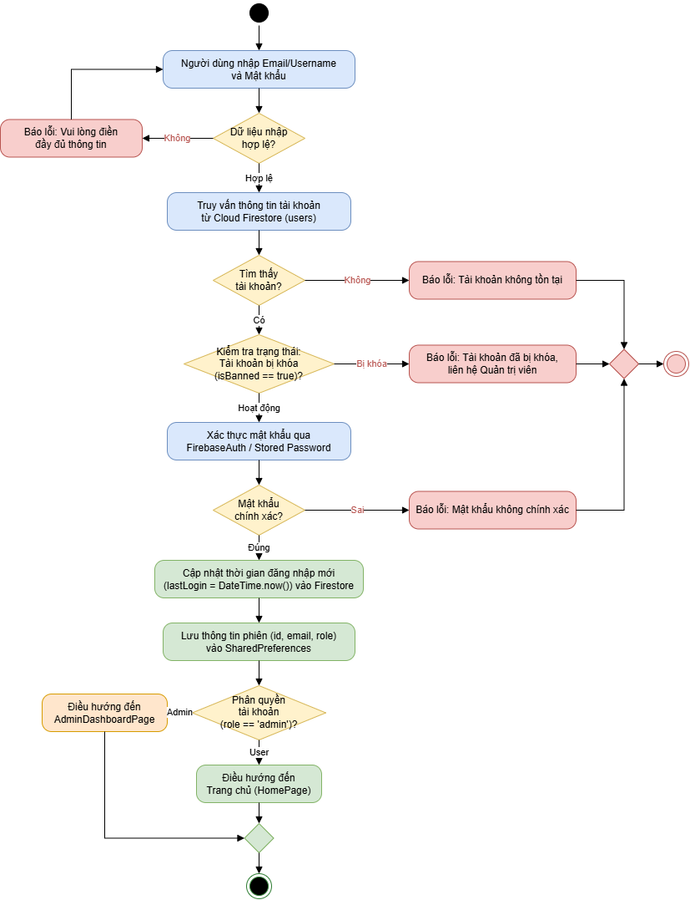

#### 📝 Tìm kiếm & Lọc phim

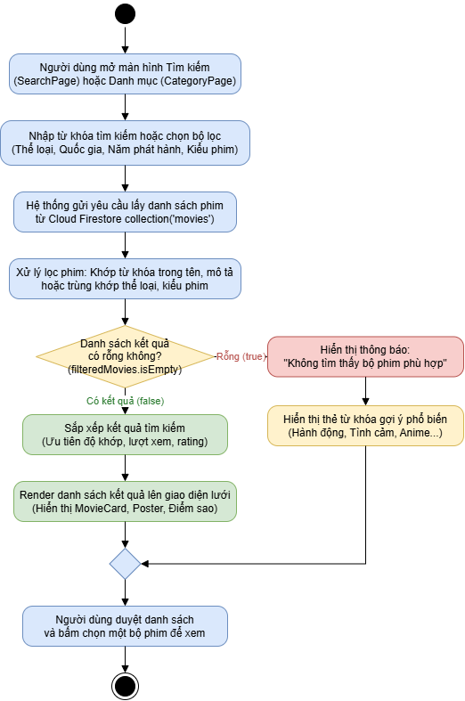

#### 🚫 Khóa tài khoản (Ban Acc — Admin)

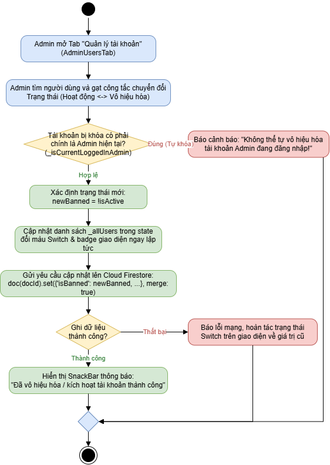

#### 🎬 Chọn tập & Phát video

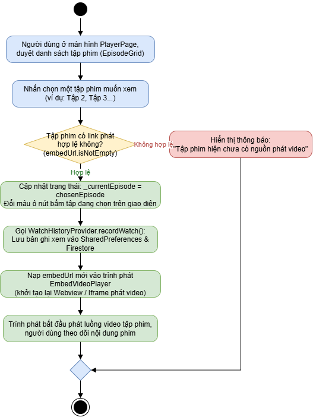

---

### 📡 Sequence Diagram — Mobile flows

#### 🔑 Login (Mobile)

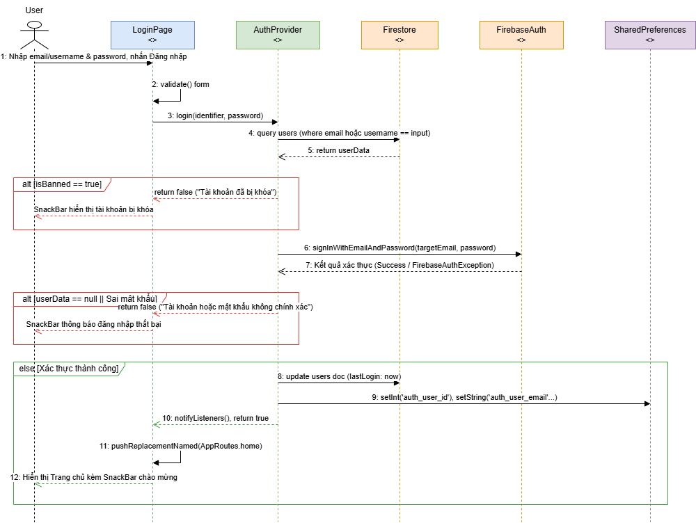

#### 📝 Đăng ký (Mobile)


#### 🔎 Tìm kiếm (Mobile)

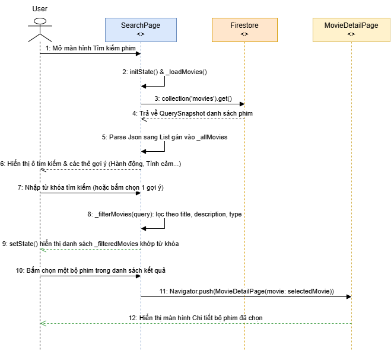

#### ▶️ Xem phim (Mobile)

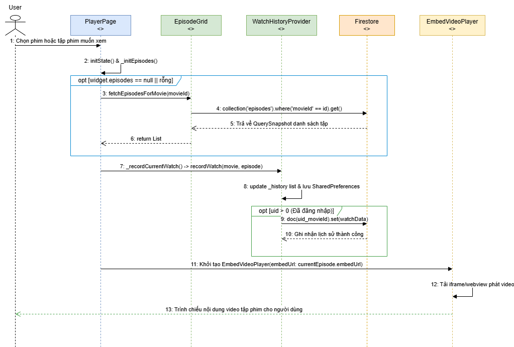

#### 💬 Bình luận (Mobile)

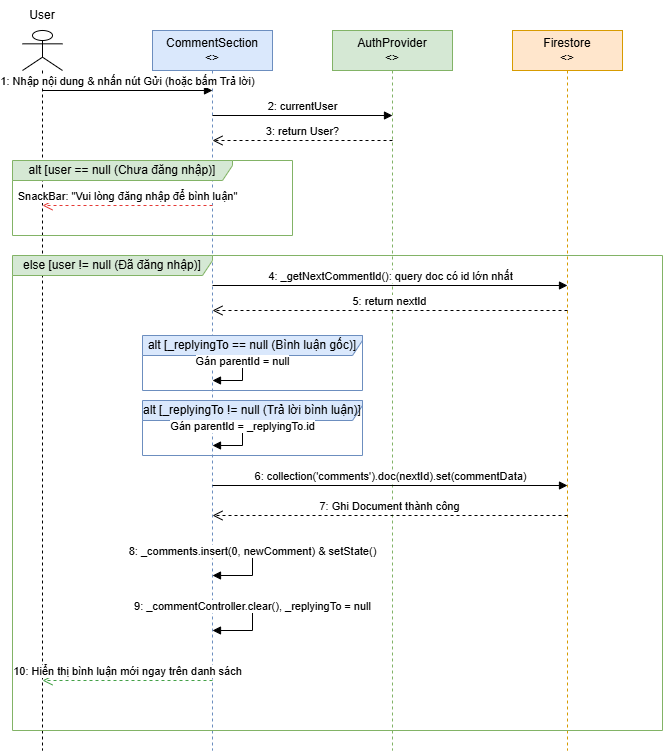

#### 👍 Like / Dislike (Mobile)

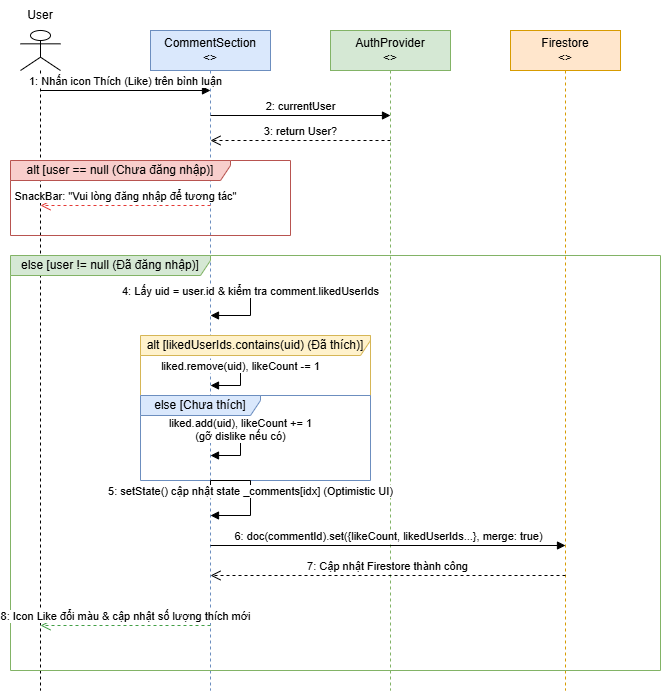

---

### 📡 Sequence Diagram — Nghiệp vụ chi tiết

#### 📖 Xem chi tiết phim

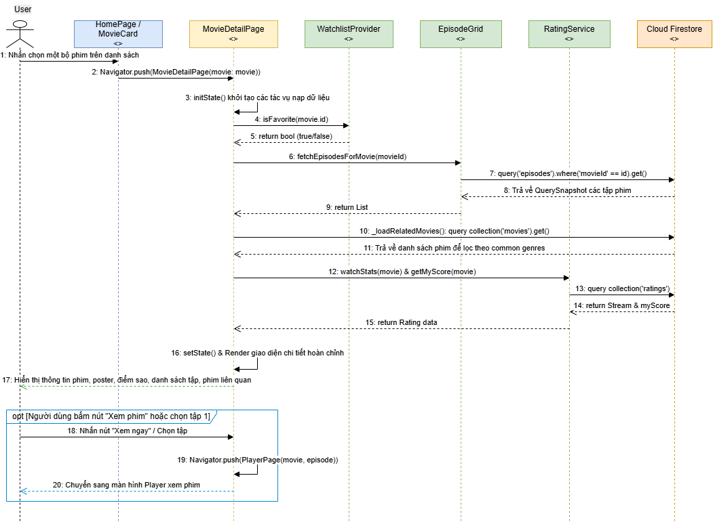

#### ❤️ Quản lý phim yêu thích

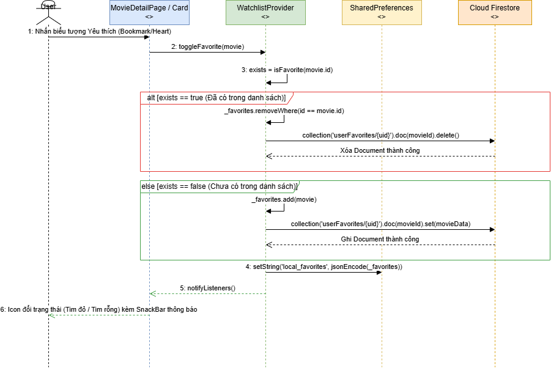

#### 🕘 Quản lý lịch sử xem

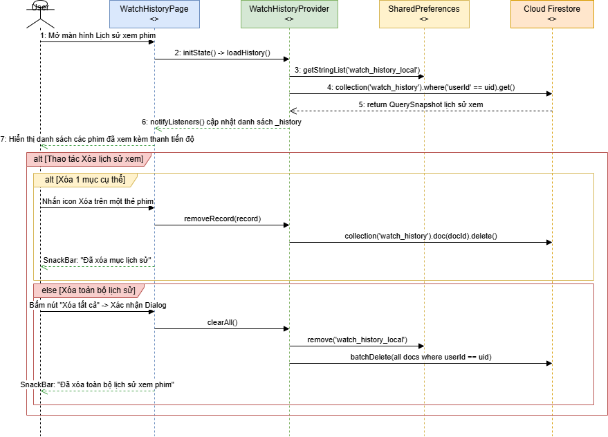

---

### 📸 Demo sản phẩm

- 🌐 **Web PWA Live:** `https://phimhay24h.onrender.com` — deploy từ `cinema_app/Dockerfile` + `render.yaml`. Lần đầu mở chờ 5–20 s để Render "đánh thức" (free tier sleep).
- 📦 **APK Android:** tab **Actions** của repo → workflow `build-apk` → tải `app-release.apk` (~59 MB) → kéo vào Appetize.io (Pixel 8, Android 14) để test không cần máy thật.

<div align="center">


</div>

## 🧪 Kiểm thử & Kiểm định (8a – 8e)

> ✅ Đã chạy toàn bộ trên nhánh `main`: **13 file · 157 ca · All tests passed!** (`flutter test` trong `cinema_app/`).

| Yêu cầu | Nội dung | File kiểm thử |
|---------|----------|---------------|
| **8a. Xử lý lỗi** | Repository bắt `ApiException` ở biên I/O → trả default an toàn, không crash app | `repositories_test.dart` |
| **8b. Unit test Core** | Validators, sanitizer, video source, utils, rate limiter, models | `validators_test.dart`, `input_sanitizer_test.dart`, `video_source_test.dart`, `generic_utils_test.dart`, `rate_limiter_test.dart`, `movie_model_test.dart`, `models_extra_test.dart`, `page_result_api_response_test.dart` |
| **8c. Full app flow** | Mô phỏng Question 1: Home → Search → Category → Favorite/Profile → Player | `app_flow_test.dart` |
| **8d. Thành công / Thất bại** | Mỗi service có case thành công + thất bại (sai format, quá dài, URL độc, spam nhanh) | Rải khắp các file trên + `movie_interactions_test.dart` |
| **8e. Widget UI** | `SearchInput`, `CustomButton`, `LoadingSpinner`, `ConfirmDialog`, `Pagination`, `RatingStars` | `common_widgets_test.dart`, `widget_test.dart` |

```bash
cd cinema_app
flutter pub get
flutter test
# 00:xx +157: All tests passed!
```

<div align="center">


</div>

## ⚙️ Cài đặt & Chạy nhanh

### Yêu cầu

- **Flutter 3.x** + Dart `>=3.12.0`
- Tài khoản Firebase (project `cinema-app-b760e`) nếu muốn chạy Auth/Firestore thật
- Trình duyệt (cho PWA) hoặc máy ảo Android (cho APK)

### 1) Chạy mobile (debug)

```bash
cd cinema_app
flutter pub get
flutter run
```

### 2) Build APK bằng GitHub Actions

- Workflow: `.github/workflows/build-apk.yml` (`flutter channel stable`, không set `flutter-version`).
- Vào **Actions → build-apk → Run workflow** trên nhánh `main` → tải Artifact `app-release-apk`.
- Muốn test không cần máy thật: upload APK lên **Appetize.io** (Pixel 8 · Android 14).

<div align="center">


</div>

## 👥 Nhóm phát triển

<div align="center">

| Thành viên | MSSV | Tài khoản GitHub | Phụ trách (mobile) |
|-----------|------|------------------|-------------------|
| Trần Quốc Việt Hùng | 24100015 | [hung123-alt](https://github.com/hung123-alt) | Search + Category + Favorite + Profile, CI APK, deploy Render, README |
| Bùi Quang Hưng | 24100129 | [hungdzx1](https://github.com/hungdzx1) | Home + Setup, Firebase, theme |
| Trần Phương Nam | 24100511 | [24100511-jpg](https://github.com/24100511-jpg) | Backend NestJS tham khảo, sơ đồ hệ thống |

</div>

<div align="center">


</div>

## 📚 Tài liệu tham khảo

- [Flutter Documentation](https://docs.flutter.dev)
- [Firebase Auth + Firestore](https://firebase.google.com/docs)
- [Firestore Security Rules](https://firebase.google.com/docs/firestore/security/get-started)
- [flutter_secure_storage](https://pub.dev/packages/flutter_secure_storage)
- [speech_to_text](https://pub.dev/packages/speech_to_text) · [flutter_tts](https://pub.dev/packages/flutter_tts)
- [NestJS Documentation](https://docs.nestjs.com) (backend tham khảo trong `server/`)
- [Render Docker Deploy](https://render.com/docs/docker) · [GitHub Actions](https://docs.github.com/actions)

---

<div align="center">


<p>
  
  &nbsp;
  
</p>

<sub>⬆️ <a href="#-mục-lục">Về đầu trang</a> · Repo: <a href="https://github.com/hung123-alt/mobile">hung123-alt/mobile</a> · Web live: <a href="https://phimhay24h.onrender.com">phimhay24h.onrender.com</a></sub>

</div>
